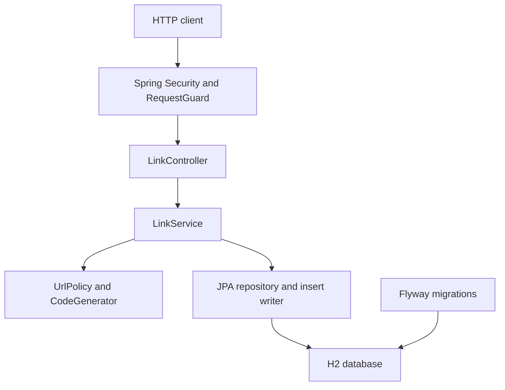

# Engineering submission

## Outcome and ownership

This submission implements a URL shortener with authenticated link management, public redirects, visit counters, expiration, and soft disabling. It contains runnable Java source, schema migrations, API definitions, automated tests, setup instructions and an AI execution record. It is an interview prototype designed with production concerns; public production release requires the controls listed below. AI generated the implementation and documentation during this session. The candidate must review, understand and own the work before presenting or releasing it. No fictitious human sign-off, multi-day work log, or production deployment is claimed.

## Requirements normalized into acceptance criteria

| ID | Decision / acceptance criterion | Implementation / evidence |
|---|---|---|
| R1 | Create a short URL for an absolute HTTP(S) target | POST endpoint; UrlPolicy; create/validation tests |
| R2 | Generated 8-character Base62 code; unique custom aliases of 4–32 characters | CodeGenerator, primary key, conflict/retry tests |
| R3 | Resolve active links with 302; unknown = 404; expired/disabled = 410 | Conditional update, service, lifecycle tests |
| R4 | Analytics means total successful GET resolutions and most recent resolution time | Atomic SQL counter; analytics and 100-concurrent-click test |
| R5 | HEAD does not count; no raw IP, user-agent or visitor records retained | Controller method discrimination, HEAD tests, schema |
| R6 | Expiry is UTC and exclusive: expiresAt <= now is expired | Injected Clock, exact-boundary test |
| R7 | All management and analytics require a header API key | RequestGuard, security tests |
| R8 | Preserve data and existing behavior through an enhancement | Flyway V2 soft-disable migration, regression and migration tests |
| R9 | Bounded execution and input | Five allocation attempts, 16KiB body limit, URL/alias limits, bounded limiter |
| R10 | Reviewable AI use, risks, setup and validation | This document, AI_EXECUTION, README, VALIDATION |

Out of scope: user accounts, billing, a frontend, geographic/unique visitor analytics, custom domains, destination previews, QR codes and cloud hosting. These were not prescribed by the assignment. No Kafka, Redis or microservice split is necessary for this scope.

## Architecture and control flow

A single modular service keeps transactions local. Controllers own HTTP contracts; LinkService owns use-case decisions; UrlPolicy validates destinations; CodeGenerator creates codes; repository operations own data access. Security is stateless. Health is exposed without database details. The app never fetches destination URLs.

**Create flow:** validate target/alias/expiry → generate code or use alias → insert and flush → commit → 201. The database primary key is the final uniqueness authority. A generated collision retries in a fresh transaction, at most five times. A custom alias collision returns 409. JPA `persist` is deliberate: `save` on an assigned ID may merge and overwrite an existing alias.

**Redirect flow:** validate request through the bounded guard → execute one conditional `clicks = clicks + 1` update for active, unexpired code → read target within the same transaction → commit → return 302, `Location`, `Cache-Control: no-store`, and `Referrer-Policy: no-referrer`. SQL arithmetic avoids lost increments. A failed conditional update is classified as missing (404), expired (410), or disabled (410). HEAD resolves without incrementing. Concurrent disable/expiry updates serialize at the database row; an already accepted in-flight redirect can still finish after a disable response.

**Analytics flow:** authenticated code lookup → return total clicks, last access, creation/expiry times, target and enabled state. Analytics are accurate for committed server-side resolutions, not proof that a browser reached the destination. Bots, retries, and clients that abandon responses can count. No unique-visitor claim is made.

## Data model

`links`: code (PK, max 32), target_url (max 2048), created_at, nullable expires_at, clicks (nonnegative BIGINT), nullable last_accessed_at, enabled (V2, default true). All times are UTC Instants. Flyway owns DDL; JPA uses validate mode. The primary-key index supports the hot path; no list query or expiry sweep requires another index. Disabled and expired codes are retained to prevent reassignment and preserve history.

## Sequenced task decomposition

1. Resolve unspecified behavior; define acceptance criteria and API boundaries.
2. Choose a single service and local persistence; define schema and migrations.
3. Implement creation, unique allocation and redirects.
4. Add analytics and expiry semantics using atomic database updates.
5. Protect management routes, validate inputs, bound request work, and standardize errors.
6. Record the greenfield baseline in local source history.
7. Add soft-disable behavior as the brownfield enhancement, with additive migration and regression tests.
8. Run build, integration/concurrency/unit tests, migration test, packaged HTTP smoke and persistence restart checks.
9. Prepare architecture, API contract, AI traceability, limitations and handoff summary.

Dependencies: schema before persistence tests; core lifecycle before analytics interpretation; baseline before enhancement; final source before packaged acceptance tests. No autonomous agent orchestration was used.

## Three scenarios

### A. Greenfield: create and resolve links

Intent: implement the initial end-to-end service. Tasks: schema → entity/repository → URL policy/code generator → service/transactions → controller → security → tests. Constraints: Java 21, Spring Boot, local runnable database, no raw visitor data, explicit alias conflicts. Validation: create/redirect/analytics lifecycle, malformed URL/body rejection, key enforcement, missing code, exact expiry boundary, generated collision recovery and concurrency. Artifacts: V1 migration, core Java classes, integration tests. The baseline commit predates the disable change; it was not a separately approved release.

### B. Brownfield: disable an existing link safely

Request: support withdrawing a shared link without destroying analytics. Impact analysis: link entity/schema, conditional redirect update, HEAD behavior, service transaction, controller API, response model and regression tests. Sequence: add V2 `enabled=true` column → expose enabled in analytics → add idempotent DELETE → exclude disabled rows from click updates → return 410 for GET/HEAD → prove history and code reservations remain. Existing links remain enabled after migration. No physical deletion or code reuse occurs. Validation: V1-to-V2 migration with an existing row; DELETE twice = 204; disabled GET/HEAD = 410; prior click total unchanged; duplicate alias still rejected. Review artifact: brownfield-change.patch plus V2 migration. Rollback: restore previous executable only after review; it ignores enabled and would reactivate disabled links, so prefer a forward fix or restrict traffic. Do not drop the enabled column while the new binary runs.

### C. Ambiguous: “provide analytics”

Unknowns: total vs unique visits, bots, time windows, privacy, consistency, cost of event storage. Chosen default: total successful GET resolutions plus last access; no HEAD, expired or disabled requests; authenticated read access; no visitor-level retention. Alternatives rejected for this prototype: raw click events (privacy/retention complexity), IP-based unique users (inaccurate identity), asynchronous queue (additional failure modes). Acceptance criteria R4/R5 were translated into controller/service behavior and tests. This is an explicit assumption for stakeholder review, not a claim that a stakeholder already approved it. Advanced analytics can be introduced later with consent/retention policy and an outbox if needed.

## Decisions, risks and trade-offs

| Choice / risk | Rationale and current control | Production follow-up |
|---|---|---|
| File-based H2 | Zero external setup, persistent demo data | PostgreSQL, tested migration dialect, backups/restore and HA; do not assume changing JDBC URL alone is sufficient |
| Synchronous click write | Simple, strongly serialized counts per link | Hot links contend on a row; consider durable events/outbox and eventual analytics after measuring |
| Shared API key | Small explicit admin boundary; no baked-in production key | OIDC/service identities, authorization per owner, key rotation, secret manager, audit trail |
| Global in-memory limiter | O(1) state; cannot leak memory from spoofed client identifiers | Gateway/Redis per-identity limits; DDoS defenses; fixed windows allow boundary bursts |
| Redirect product abuse | Only HTTP(S), credentials/control characters rejected; service never fetches URLs | Abuse reporting, phishing/malware screening, ownership policies; private destination redirects remain permitted |
| Input / errors | Bean validation, bounded body, parameterized JPA, generic storage errors | Gateway read timeouts and size limits; TLS, full security review; sanitize SQL error logging |
| Redirect counting | Exact committed increments; no-store stops normal cache bypass | Network failures after commit can overcount; not exactly-once visit accounting |
| Codes are public identifiers | SecureRandom, 62^8 space, DB uniqueness and bounded retry | No confidential URLs without additional access policy; codes are not authorization tokens |
| Retention | Keep rows so links never silently point to a new owner | Define retention, purge/tombstone, storage capacity and legal policies |
| High-impact operations | Additive schema and idempotent disable | Human review before public deployment, data migration or irreversible cleanup |

Availability favors correctness: if storage is unavailable, return 503 rather than redirect without recording analytics. This couples redirect availability to the database. A read-cache/async design would need explicitly different semantics.

## Quality gates and controlled oversight

Required local gate: `./mvnw clean verify` (JDK enforcement, compilation/static type checks, tests, packaging, coverage report). Additional evidence: real packaged-server smoke, persistent restart and fail-fast configuration checks. Compiler lint is enabled with warnings treated as errors (excluding processing/serial warnings). A dedicated style linter, dependency vulnerability database scan, penetration test, Docker execution and production load test are not claimed as completed. Before public release, run an organization-approved SCA scanner, review findings and licenses, add a style/static-analysis gate to CI, and verify deployment/backup/monitoring procedures. No secrets or customer data were submitted to AI; only synthetic URLs and keys are used in tests. Do not paste real URL query tokens, keys or internal source into an unapproved model.

The engineer should review all code and tests, reproduce the demo, understand transaction/collision behavior, validate the selected analytics semantics and approve any deployment. This package does not include forged approvals.

## Final engineering summary

The service implements the agreed prototype assumptions with clear module boundaries, atomic counting, database uniqueness, secure defaults, bounded request work and additive migration handling. Deliverables include all source, executable, API/schema definitions, tests, three scenarios, AI execution decisions and actual validation results. Principal limitations are single-node persistence, shared-key administration, synchronous hot-row counting, limited abuse protection and no production deployment approval. See VALIDATION.md for measured results and their scope.

Reference: Spring Boot system requirements: https://docs.spring.io/spring-boot/3.5/system-requirements.html (used to check Java/Maven compatibility; dependency versions are pinned in pom.xml, not claimed to be latest).
